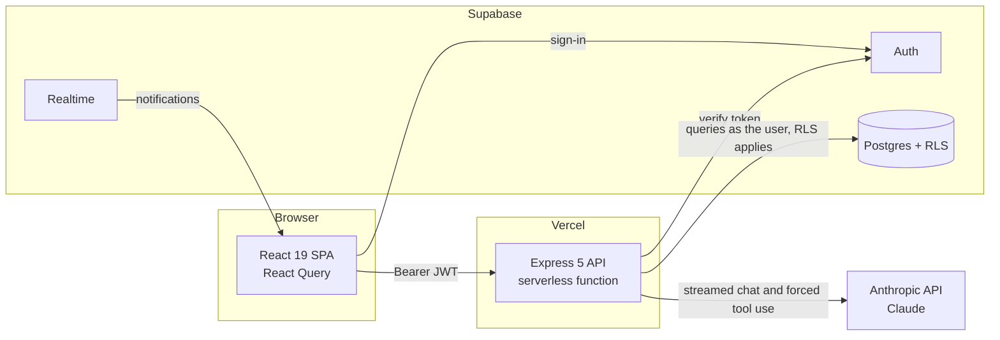

# Trackit

An AI study planner that turns a student's timetable into a prioritised, deadline-aware workload, with an assistant grounded in their own tasks and exams.

[](https://github.com/Ohm-Kel/trackit/actions/workflows/ci.yml)
[](LICENSE)


**Live demo:** [trackit-app-smoky.vercel.app](https://trackit-app-smoky.vercel.app) · **API docs:** `/api/docs` on any running instance

---

## Problem and solution

University students juggle assignments, exams and class schedules spread across PDFs, portals and photos of notice boards. Re-typing them into a planner is tedious, and generic chatbots give study advice without knowing what is actually due.

Trackit closes that gap in three steps:

1. **Capture**: upload an exam timetable or class schedule as a PDF or photo. Claude extracts structured records through schema-enforced tool use, and the student reviews them before importing.
2. **Prioritise**: tasks carry due dates, grade weights and effort estimates. Analytics flag deadline clusters, and a focus plan fits work into the free time between classes.
3. **Advise**: the study assistant answers with the student's live workload in context, so "what should I do first?" gets an answer based on real deadlines and weights.

## Features

- **Timetable extraction**: PDF, PNG, JPG or WebP to exams or a weekly schedule, with row-level validation and a review step before import
- **Grounded study assistant**: chat with Claude, using the student's tasks and exams as context; replies stream in as they are generated, with prompt-injection hardening
- **Tasks and exams**: due dates, grade weights, effort estimates, confidence levels and subtasks
- **Focus plan**: a schedule-aware daily plan built around class times
- **Analytics**: completion velocity, deadline-cluster ("burnout") detection and workload by grade weight
- **Notifications**: in-app and browser reminders for upcoming deadlines, delivered in real time
- **Export**: tasks and exams as CSV or PDF, plus a full JSON backup
- **Dark mode** and a guided onboarding tour

## Architecture



- The **frontend** signs in with Supabase Auth and calls the API with the user's access token. It reads notifications directly through Supabase Realtime, protected by Row Level Security.
- The **API** verifies every token, validates every request with Zod, and queries Supabase as the signed-in user, so Row Level Security applies on top of explicit `user_id` filters. It is the only component holding the Anthropic and Supabase service keys.
- **AI calls** are rate-limited per user, with counters shared across serverless instances in Postgres. Chat history sent to the model is capped, and token usage is logged.

Key decisions are recorded as ADRs in [`docs/adr`](docs/adr):
[structured output through tool use](docs/adr/0001-structured-output-via-tool-use.md),
[rate limiting AI endpoints with shared counters](docs/adr/0002-rate-limit-ai-endpoints.md),
[the API as the authorisation boundary, with RLS on API queries](docs/adr/0003-api-as-authorization-boundary.md).

## Tech stack

| Layer | Technology |
|---|---|
| Frontend | React 19, Vite 7, Tailwind CSS 4, TanStack React Query 5, React Router 7, Recharts |
| Backend | Node.js 22, Express 5, Zod 4, pino, helmet, express-rate-limit |
| AI | Anthropic SDK (Claude Haiku 4.5 by default), vision and PDF input, forced tool use |
| Data and auth | Supabase Postgres with Row Level Security, Supabase Auth and Realtime |
| Quality | Jest and Supertest (102 tests, 95% line coverage), ESLint, Prettier, pre-commit, GitHub Actions |
| Delivery | Vercel (frontend and serverless API), Docker and Docker Compose |

## Getting started

### Prerequisites

- Node.js 20 or later
- A [Supabase](https://supabase.com) project
- An [Anthropic API key](https://console.anthropic.com)
- Docker (optional, for the containerised setup)

### 1. Clone and install

```bash
git clone https://github.com/Ohm-Kel/trackit.git
cd trackit
(cd backend && npm ci)
(cd frontend && npm ci)
```

### 2. Set up the database

In the Supabase SQL editor, run `supabase_schema.sql`, then `supabase_migrations.sql`, then `supabase_migrations_002.sql`. They create the tables, Row Level Security policies, the trigger that creates a profile on sign-up, and the shared rate-limit counters.

### 3. Configure environment variables

```bash
cp backend/.env.example backend/.env     # Supabase service key, Anthropic key
cp frontend/.env.example frontend/.env   # Supabase URL and anon key
```

| Variable | Where | Purpose |
|---|---|---|
| `SUPABASE_URL`, `SUPABASE_SERVICE_KEY` | backend | Token verification and rate-limit counters (service role; server only) |
| `SUPABASE_ANON_KEY` | backend | Queries run as the signed-in user so Row Level Security applies |
| `ANTHROPIC_API_KEY` | backend | Claude API |
| `ANTHROPIC_MODEL` | backend | Optional model override |
| `ALLOWED_ORIGINS` | backend | Comma-separated CORS allowlist |
| `AI_CHAT_RATE_LIMIT`, `AI_UPLOAD_RATE_LIMIT` | backend | Requests per user per hour (defaults 30 and 10) |
| `RATE_LIMIT_STORE` | backend | `supabase` (default, shared across instances) or `memory` |
| `VITE_SUPABASE_URL`, `VITE_SUPABASE_ANON_KEY` | frontend | Public Supabase client config |
| `VITE_API_URL` | frontend | API base URL in development |

See [`backend/.env.example`](backend/.env.example) for every option.

### 4. Run locally

```bash
cd backend && npm run dev      # API on http://localhost:3001
cd frontend && npm run dev     # App on http://localhost:5173
```

Or run both in containers (needs `backend/.env` and a root `.env` copied from `.env.example`):

```bash
docker compose up --build      # App on http://localhost:8080
```

### 5. Run the checks

```bash
cd backend
npm test                 # unit and integration tests
npm run test:coverage    # with coverage (85% line gate)
npm run lint && npm run format:check
npm run eval -- --oracle # evaluation harness self-check (no API calls)

# Schema, migrations and RLS policies, against an empty Postgres database
DATABASE_URL=postgres://postgres@localhost:5432/postgres ../scripts/db/test.sh
```

## Usage examples

Interactive documentation is served at `/api/docs`, generated from the same Zod schemas the API validates with.

```bash
TOKEN=<supabase-access-token>

# Ask the study assistant
curl -X POST http://localhost:3001/api/chat \
  -H "Authorization: Bearer $TOKEN" -H "Content-Type: application/json" \
  -d '{"message": "What should I work on first this week?"}'

# Same question, with the reply streamed as server-sent events
curl -N -X POST http://localhost:3001/api/chat/stream \
  -H "Authorization: Bearer $TOKEN" -H "Content-Type: application/json" \
  -d '{"message": "What should I work on first this week?"}'

# Extract exams from a PDF timetable
curl -X POST http://localhost:3001/api/upload/parse \
  -H "Authorization: Bearer $TOKEN" -H "Content-Type: application/json" \
  -d "{\"file\": \"$(base64 -w0 timetable.pdf)\", \"mimeType\": \"application/pdf\", \"type\": \"exam\"}"
```

## Evaluation

The timetable parser is measured against a versioned, reproducible evaluation set rather than judged by eye. Full details are in [`backend/eval/README.md`](backend/eval/README.md).

- **Dataset v1**: 20 synthetic documents (14 exam timetables, 6 class schedules, 145 ground-truth records) generated from a fixed seed. They vary layout, five date formats, 12- and 24-hour and French times, English and French text, missing fields, distractor text, and text PDFs versus rasterised images.
- **Metrics**: record-level precision, recall and F1; per-field accuracy for date, time, course code and venue; an exact-record rate; and breakdowns by slice.
- **Reproducibility**: each run logs the model, temperature, dataset version and seed, git commit and token usage.

Run `npm run eval` in `backend/` with an Anthropic key to produce the results table.

## Project structure

```
trackit/
├── api/index.js              # Vercel serverless entry point
├── backend/
│   ├── app.js                # Express app: security middleware, routing, errors
│   ├── server.js             # Local and container entry point
│   ├── config.js             # Typed environment configuration
│   ├── controllers/          # Request handlers and Zod request schemas
│   ├── lib/                  # Timetable parser, chat context, analytics, OpenAPI
│   ├── middleware/           # Auth, rate limiting, error handling
│   ├── routes/               # Express routers
│   ├── tests/                # Jest unit and integration tests
│   └── eval/                 # Evaluation dataset, scorer and runner
├── frontend/
│   └── src/                  # Pages, components, hooks, API client
├── docs/adr/                 # Architecture decision records
├── scripts/                  # Repository checks; db/ holds the RLS test suite
├── supabase_schema.sql       # Tables, RLS policies, triggers
├── supabase_migrations.sql   # Later additions (subtasks, chat history, schedule)
├── supabase_migrations_002.sql # Rate-limit counters and RLS fixes (v1.2.0)
└── docker-compose.yml
```

## Roadmap

- Add anonymised real-world timetables (scans, photos, multi-page PDFs) as evaluation set v2
- Frontend component tests with Vitest and React Testing Library

## Contributors

- **Semanu Kwaku Sebuava** ([@Ohm-Kel](https://github.com/Ohm-Kel)): design, full-stack development, AI integration and evaluation

See [CONTRIBUTING.md](CONTRIBUTING.md) for the workflow and conventions.

## License

[MIT](LICENSE) © 2026 Semanu Kwaku Sebuava
